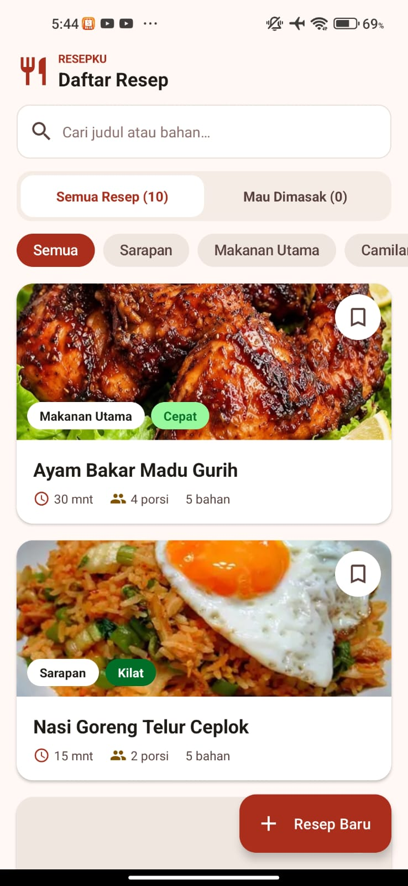

# Sebelumnya ini aplikasi ya gak tau saya iseng aja mau nyari tema apa dan kepikiran bikin aplikasi ini doang and then jadinya ya kaya gini
Nama : Daffa syafiq faiz (24091006)
 
NOTED : gausah tanya pake agent apa, udah kelihatan di contribution, tapi saya ini combo dengan agent lain jadi bukan cuman 1 saja tapi ada beberapa yg saya combo biar maksimal walaupun masih banyak kurangnya tapi setidaknya ini untuk pembelajaran saja dan akan saya tingkatin lagi untuk pemahaman saya mengenai web app dan yang lainnya serta lagi belajar REA.

# ResepKu

Aplikasi Android untuk menyimpan dan menelusuri resep yang ingin dimasak, serta menghitung ulang takaran bahan sesuai jumlah porsi. Dibuat dengan Kotlin untuk Tugas 2 mata kuliah Pemrograman Mobile (Pertemuan 7).

## Fitur

- **Daftar resep:** 10 resep bawaan dengan label waktu Kilat, Cepat, Sedang, atau Lama.
- **Cari dan filter:** cari berdasarkan judul atau nama bahan, lalu saring berdasarkan kategori.
- **Mau Dimasak:** tandai resep dan lihat dalam satu daftar.
- **Hitung porsi:** masukkan porsi 1–50, lalu lihat bahan yang sudah dihitung ulang di layar baru.
- **Tambah resep:** formulir resep baru dengan validasi berurutan.

Contoh hitung porsi: resep 4 porsi memakai 200 g ayam. Bila diminta 6 porsi, faktornya 1.5 dan hasilnya 300 g ayam.

## Menjalankan Aplikasi

**Yang dibutuhkan**

- Android Studio, atau JDK 17+ dan Android SDK 35
- HP atau emulator dengan Android 7.0 (API 24) ke atas

**Dengan Android Studio**

1. Clone repository ini. Ganti `USERNAME/NAMA-REPO` dengan alamat repository ini.

   ```bash
   git clone https://github.com/USERNAME/NAMA-REPO.git
   ```

2. Buka foldernya di Android Studio, lalu tunggu proses Gradle Sync selesai.
3. Pilih HP atau emulator, lalu klik **Run**.

**Dengan command line**

Buat file `local.properties` di folder utama bila belum ada, lalu isi dengan lokasi Android SDK:

```properties
sdk.dir=C\:\\Users\\NAMA\\AppData\\Local\\Android\\Sdk
```

Setelah itu, build APK:

```bash
./gradlew assembleDebug
```

APK akan tersimpan di `app/build/outputs/apk/debug/app-debug.apk`.

## Pengujian

```bash
./gradlew testDebugUnitTest
```

Tes mencakup logika hitung, validasi input, dan alur layar. Tes berjalan tanpa emulator karena memakai Robolectric.

## Struktur Proyek

```text
app/src/main/java/com/resepku/app/
├── model/    Data class sesuai ERD
├── data/     Repository dan resep bawaan
├── logic/    Validasi dan perhitungan porsi
└── ui/       Activity dan adapter
docs/         Dokumen PRD dan ERD
```

## Teknologi

- Kotlin dan Android Views (XML, ViewBinding)
- Material Components dan RecyclerView
- JUnit dan Robolectric untuk pengujian

## Batasan

- Data disimpan di memori. Resep tambahan dan tanda Mau Dimasak hilang saat proses aplikasi berakhir.
- Resep memakai gambar placeholder, belum memakai foto makanan.

## Dokumentasi

Hasilnya

## 📸 Screenshot Aplikasi

Berikut adalah tampilan dari aplikasi:

<p align="center">
  
  
  
  
</p>

---

## 🎥 Demo Aplikasi

Berikut adalah video demonstrasi penggunaan aplikasi:

📹 Video Demo Aplikasi: 👉 [▶️ Download & Tonton Video Demo (MP4)](Demo%20Aplikasi.mp4) *(Atau klik tombol "View raw" di halaman file GitHub untuk mendownloadnya dulu walaupun 6mb)*
