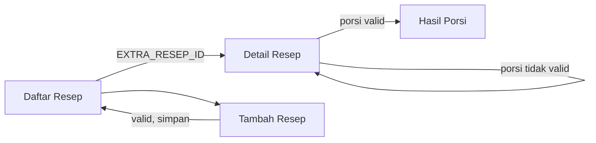
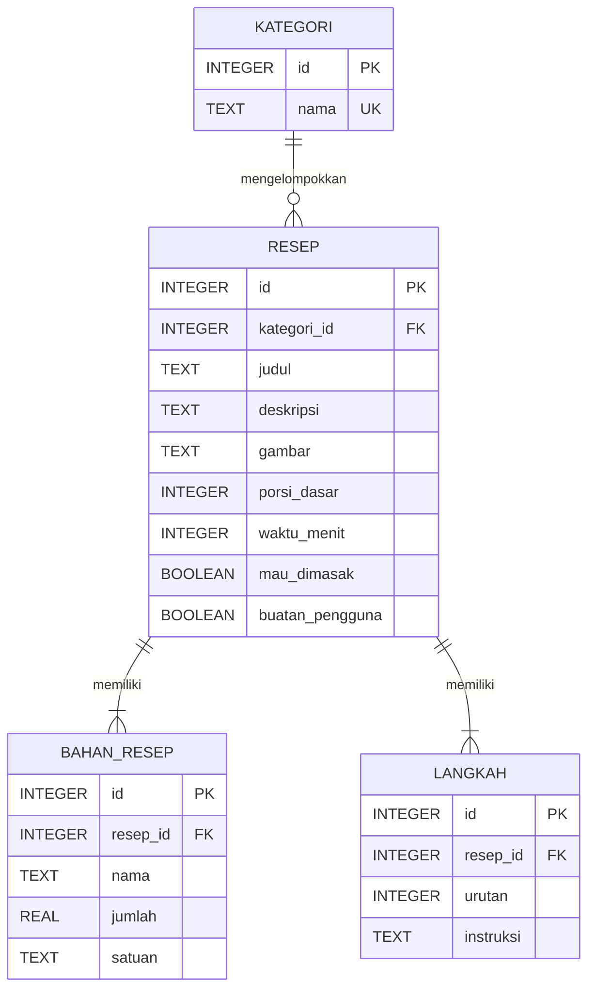

# PRD dan ERD — Aplikasi Resep Makanan

| | |
|---|---|
| **Mata kuliah** | Pemrograman Mobile, Pertemuan 7 (Sub-CPMK 3.2) |
| **Tugas** | Tugas 2 — Logika Interaktif & Navigasi (individu, bobot 15%) |
| **Platform** | Android, Kotlin |
| **Status** | Draf, menunggu persetujuan |

## 1. Ringkasan

Aplikasi untuk menyimpan dan menelusuri resep yang ingin dimasak. Pengguna dapat mencari resep, menandai resep yang ingin dimasak, dan menghitung ulang jumlah bahan sesuai porsi yang diinginkan.

Fitur inti untuk Tugas 2 adalah **Hitung Porsi**: pengguna memasukkan jumlah porsi, aplikasi memvalidasi input, menghitung ulang bahan, lalu membawa hasilnya ke layar baru.

## 2. Requirement yang Disusun Ulang

### 2.1 Requirement dari tugas

| ID | Ketentuan (materi slide 15) | Pemenuhan di aplikasi |
|---|---|---|
| T-1 | Pengembangan aplikasi Tugas 1, tema bebas | Belum ada aplikasi Tugas 1, sehingga proyek dimulai baru. Lihat bagian 11. |
| T-2 | Minimal satu interaksi logis: input diproses dan ditampilkan | Hitung Porsi (F-05) |
| T-3 | Validasi input minimal satu kolom | Kolom porsi (F-05) dan formulir resep (F-07) |
| T-4 | Navigasi ke minimal satu layar baru membawa hasil olahan | Detail Resep ke Hasil Porsi lewat `Intent` (F-06) |
| T-5 | Luaran: repository GitHub | Repository proyek |
| T-6 | Luaran: video demo 1–2 menit | Naskah di bagian 10 |

### 2.2 Requirement dari tema

Permintaan awal adalah aplikasi yang berisi "semua resep yang ingin dimasak". Aplikasi tidak mungkin memuat semua resep yang ada, sehingga requirement ini diartikan sebagai berikut:

- Aplikasi menyediakan resep bawaan.
- Pengguna dapat menambah resep sendiri.
- Pengguna dapat menandai resep yang ingin dimasak dan melihatnya dalam satu daftar.

## 3. Tujuan dan Pengguna

**Tujuan**

- Memenuhi seluruh ketentuan Tugas 2.
- Menerapkan pola Input > Proses > Output dan prinsip "periksa dulu, olah kemudian".
- Tidak crash pada input apa pun di semua kolom.

**Pengguna**: satu orang yang memasak di rumah dan memakai aplikasi di ponselnya sendiri. Aplikasi tidak memerlukan akun.

## 4. Ruang Lingkup

**Termasuk**

- Daftar, pencarian, dan filter resep
- Detail resep
- Penanda "Mau Dimasak"
- Hitung porsi
- Tambah resep

**Tidak termasuk**

- Login dan akun
- API atau sinkronisasi cloud
- Unggah foto
- Rating dan komentar
- Daftar belanja

## 5. Kebutuhan Fungsional

Prioritas: **Wajib** diperlukan untuk memenuhi tugas atau alur inti. **Tambahan** dikerjakan bila waktu cukup.

| ID | Fitur | Deskripsi | Prioritas |
|---|---|---|---|
| F-01 | Daftar resep | Menampilkan judul, kategori, waktu masak, dan label waktu. Tersedia minimal 10 resep bawaan. | Wajib |
| F-02 | Detail resep | Menampilkan deskripsi, porsi dasar, bahan, dan langkah berurutan. | Wajib |
| F-03 | Label waktu | Mengubah waktu masak menjadi label dengan `when` (bagian 7.2). | Wajib |
| F-04 | Mau Dimasak | Menandai atau melepas tanda resep, dan menampilkan hanya resep yang ditandai. | Wajib |
| F-05 | Hitung porsi | Memvalidasi input porsi, lalu menghitung faktor pengali. | Wajib |
| F-06 | Hasil porsi | Layar baru yang menerima hasil olahan dan menampilkan bahan yang sudah dihitung ulang. | Wajib |
| F-07 | Tambah resep | Formulir resep baru dengan validasi berurutan (bagian 7.1). | Tambahan |
| F-08 | Cari resep | Mencari berdasarkan judul atau nama bahan. | Tambahan |
| F-09 | Filter kategori | Menyaring daftar berdasarkan kategori. | Tambahan |

## 6. Layar dan Navigasi

| Layar | Activity | Isi |
|---|---|---|
| Daftar Resep | `MainActivity` | Pencarian, filter, daftar resep, tombol tambah |
| Detail Resep | `DetailActivity` | Info resep, tombol Mau Dimasak, input porsi, tombol Hitung |
| Hasil Porsi | `HasilPorsiActivity` | Porsi target, faktor pengali, bahan hasil hitung |
| Tambah Resep | `TambahResepActivity` | Formulir resep baru |



Data yang dikirim ke Hasil Porsi:

| Kunci | Tipe | Isi | Cara membaca |
|---|---|---|---|
| `EXTRA_RESEP_ID` | Int | ID resep | `getIntExtra(EXTRA_RESEP_ID, -1)` |
| `EXTRA_PORSI_TARGET` | Int | Porsi yang diminta | `getIntExtra(EXTRA_PORSI_TARGET, -1)` |
| `EXTRA_FAKTOR` | Double | Hasil olahan: faktor pengali | `getDoubleExtra(EXTRA_FAKTOR, -1.0)` |

Kunci disimpan sebagai konstanta `companion object` di `HasilPorsiActivity`.

## 7. Logika Program

### 7.1 Aturan validasi

Setiap kolom diperiksa berurutan. Saat satu pemeriksaan gagal, aplikasi memasang `error` pada kolom, memindahkan fokus ke kolom itu, lalu berhenti dengan `return@setOnClickListener`.

**Hitung Porsi**

| Urutan | Kondisi gagal | Pesan |
|---|---|---|
| 1 | Kolom kosong | Porsi tidak boleh kosong |
| 2 | `toIntOrNull()` menghasilkan `null` | Porsi harus berupa angka bulat |
| 3 | Di luar 1–50 | Porsi harus antara 1 dan 50 |

**Tambah Resep**

| Urutan | Kolom | Aturan |
|---|---|---|
| 1 | Judul | Wajib, minimal 3 karakter setelah `trim()` |
| 2 | Kategori | Wajib dipilih |
| 3 | Porsi dasar | Wajib, bilangan bulat 1–50 |
| 4 | Waktu masak | Wajib, bilangan bulat 1–1440 menit |
| 5 | Bahan | Minimal 1 baris dengan nama terisi |
| 6 | Jumlah bahan | Boleh kosong (berarti "secukupnya"). Bila terisi, `toDoubleOrNull()` harus lebih dari 0. |
| 7 | Langkah | Minimal 1 langkah terisi |

`inputType="number"` tetap dipasang, tetapi tidak dianggap cukup karena teks tempelan bisa melewati keyboard. Validasi di kode tetap wajib.

### 7.2 Perhitungan

```kotlin
val faktor = porsiTarget.toDouble() / resep.porsiDasar
val jumlahBaru = bahan.jumlah?.let { it * faktor }  // null berarti "secukupnya"

val labelWaktu = when (resep.waktuMenit) {
    in 1..15 -> "Kilat"
    in 16..30 -> "Cepat"
    in 31..60 -> "Sedang"
    else -> "Lama"
}
```

Contoh: resep untuk 4 porsi memakai 200 g ayam. Bila diminta 6 porsi, faktornya 1,5 dan hasilnya 300 g ayam.

Aturan tampilan:

- Angka dibulatkan maksimal 2 desimal.
- Angka bulat ditampilkan tanpa desimal (`300`, bukan `300.0`).
- Bahan tanpa jumlah tetap tampil sebagai "secukupnya".
- Waktu masak tidak ikut dikalikan, karena waktu masak tidak naik sebanding dengan porsi.

## 8. Kebutuhan Non-Fungsional

| ID | Kebutuhan |
|---|---|
| NF-1 | Tidak crash pada input kosong, huruf, simbol, atau angka sangat besar. |
| NF-2 | Berjalan tanpa internet. |
| NF-3 | Teks tampilan disimpan di `strings.xml`, dan nama kelas serta variabel konsisten. |
| NF-4 | Logika hitung dan validasi dipisahkan dari Activity agar kode rapi dan mudah diuji. |

**Penyimpanan data**: Tugas 2 memakai data `data class` di dalam memori melalui satu kelas repository, karena materi Pertemuan 1–7 belum membahas database. Akibatnya, resep tambahan dan tanda Mau Dimasak **hilang saat proses aplikasi berakhir**. Struktur kelas mengikuti ERD sehingga dapat dipindahkan ke Room nanti.

## 9. Pengujian

| ID | Input | Hasil yang diharapkan |
|---|---|---|
| U-01 | Porsi `6` pada resep 4 porsi | Pindah layar, faktor 1,5, bahan benar |
| U-02 | Porsi `4` pada resep 4 porsi | Pindah layar, jumlah bahan tidak berubah |
| U-03 | Porsi kosong | Pesan error di kolom, tetap di layar, tidak crash |
| U-04 | Porsi `dua` (ditempel) | Pesan error di kolom, tetap di layar, tidak crash |
| U-05 | Porsi `0` | Pesan error rentang, tetap di layar |
| U-06 | Porsi `51` | Pesan error rentang, tetap di layar |
| U-07 | Porsi `99999999999` | Pesan error angka bulat, tidak crash |
| U-08 | Bahan "secukupnya" | Tetap tampil "secukupnya" di Hasil Porsi |
| U-09 | Waktu 15, 16, 30, 31, 60, 61 menit | Kilat, Cepat, Cepat, Sedang, Sedang, Lama |
| U-10 | Judul resep hanya berisi spasi | Pesan error di kolom judul, resep tidak tersimpan |
| U-11 | Tandai Mau Dimasak, lalu kembali ke daftar | Resep muncul pada daftar Mau Dimasak |

## 10. Pemetaan Rubrik dan Luaran

| Rubrik | Skor | Bukti |
|---|---|---|
| Fungsi logika sesuai tujuan | 40 | F-03, F-05, validasi bagian 7.1 |
| Kelancaran navigasi | 25 | Alur bagian 6, tombol kembali berfungsi |
| Kreativitas eksplorasi | 20 | F-04, F-07, F-08, F-09 |
| Kerapian kode | 15 | NF-3, NF-4 |

**Naskah video demo (1–2 menit)**

1. Buka daftar resep, lalu buka satu detail resep.
2. Isi porsi dengan `abc` atau kosongkan kolom, lalu tunjukkan pesan error dan bahwa layar tidak berpindah.
3. Isi porsi `6`, lalu tunjukkan bahan hasil hitung di layar Hasil Porsi.
4. Kembali, lalu tandai resep sebagai Mau Dimasak.

## 11. Keputusan dan Risiko

1. **Aplikasi Tugas 1**: belum ada, sehingga proyek ini dimulai dari awal. Ketentuan tugas menyebut Tugas 2 adalah pengembangan aplikasi Tugas 1, jadi hal ini sebaiknya disampaikan kepada dosen.

## 12. ERD: Diagram



## 13. ERD: Relasi

| Relasi | Kardinalitas | Arti |
|---|---|---|
| KATEGORI ke RESEP | 1 ke 0..N | Satu kategori memiliki nol atau banyak resep. Setiap resep memiliki tepat satu kategori. |
| RESEP ke BAHAN_RESEP | 1 ke 1..N | Satu resep memiliki minimal satu bahan. |
| RESEP ke LANGKAH | 1 ke 1..N | Satu resep memiliki minimal satu langkah. |

## 14. ERD: Kamus Data

### KATEGORI

| Atribut | Tipe | Wajib | Aturan |
|---|---|---|---|
| `id` | INTEGER | Ya | Primary key |
| `nama` | TEXT | Ya | Unik, contoh: Sarapan, Makanan Utama, Camilan, Minuman |

### RESEP

| Atribut | Tipe | Wajib | Aturan |
|---|---|---|---|
| `id` | INTEGER | Ya | Primary key |
| `kategori_id` | INTEGER | Ya | Foreign key ke `KATEGORI.id` |
| `judul` | TEXT | Ya | Minimal 3 karakter |
| `deskripsi` | TEXT | Tidak | |
| `gambar` | TEXT | Tidak | Nama drawable. Kosong berarti memakai gambar placeholder. |
| `porsi_dasar` | INTEGER | Ya | 1–50 |
| `waktu_menit` | INTEGER | Ya | 1–1440 |
| `mau_dimasak` | BOOLEAN | Ya | Default `false` |
| `buatan_pengguna` | BOOLEAN | Ya | `false` untuk resep bawaan |

### BAHAN_RESEP

| Atribut | Tipe | Wajib | Aturan |
|---|---|---|---|
| `id` | INTEGER | Ya | Primary key |
| `resep_id` | INTEGER | Ya | Foreign key ke `RESEP.id` |
| `nama` | TEXT | Ya | Contoh: Dada ayam |
| `jumlah` | REAL | Tidak | Lebih dari 0. Kosong berarti "secukupnya". |
| `satuan` | TEXT | Tidak | Contoh: g, sdm, butir |

### LANGKAH

| Atribut | Tipe | Wajib | Aturan |
|---|---|---|---|
| `id` | INTEGER | Ya | Primary key |
| `resep_id` | INTEGER | Ya | Foreign key ke `RESEP.id` |
| `urutan` | INTEGER | Ya | Mulai dari 1, unik dalam satu resep |
| `instruksi` | TEXT | Ya | |

## 15. ERD: Keputusan Desain

- **Tidak ada tabel pengguna.** Aplikasi dipakai satu orang tanpa login.
- **Bahan disimpan per resep, tanpa tabel master bahan.** Jumlah dan satuan selalu milik satu resep, dan pencarian nama bahan tetap bisa dilakukan. Tabel master hanya menambah kerumitan pada formulir Tambah Resep.
- **Hasil hitung porsi tidak disimpan.** Faktor dan jumlah baru dihitung dari `porsi_dasar` dan `jumlah`, lalu dikirim lewat `Intent`.
- **Label waktu tidak disimpan.** Label diturunkan dari `waktu_menit` dengan `when`.
- **`mau_dimasak` berada di RESEP.** Satu pengguna hanya memerlukan satu penanda untuk setiap resep.

## 16. ERD: Pemetaan ke Kotlin

Untuk Tugas 2, setiap entitas menjadi `data class` yang disimpan di memori, karena materi Pertemuan 1–7 belum membahas database.

```kotlin
data class Kategori(
    val id: Int,
    val nama: String
)

data class Resep(
    val id: Int,
    val kategoriId: Int,
    val judul: String,
    val deskripsi: String? = null,
    val gambar: String? = null,
    val porsiDasar: Int,
    val waktuMenit: Int,
    var mauDimasak: Boolean = false,
    val buatanPengguna: Boolean = false
)

data class BahanResep(
    val id: Int,
    val resepId: Int,
    val nama: String,
    val jumlah: Double? = null,
    val satuan: String? = null
)

data class Langkah(
    val id: Int,
    val resepId: Int,
    val urutan: Int,
    val instruksi: String
)
```
